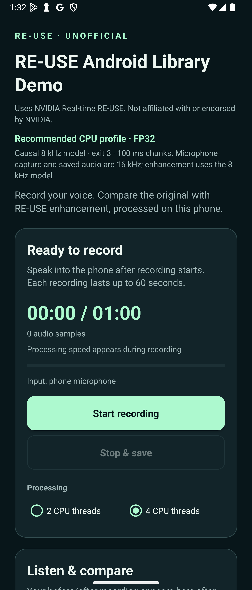

# RE-USE Android — Unofficial

[](docs/phone-demo.md#requirements-and-scope)
[](docs/phone-demo.md#requirements-and-scope)
[](https://github.com/Keitark/RE-USE-android-unofficial/releases/tag/v0.1.1-preview1)
[](docs/license.md)

An unofficial Android integration of NVIDIA Real-time RE-USE. This project is
not affiliated with, endorsed by, or maintained by NVIDIA.

**Try on-device speech enhancement with your phone's microphone.** Record,
compare the original and enhanced audio, and share the WAV pair. No G2 glasses,
Even app, account, or cloud audio service is required.

[](https://github.com/Keitark/RE-USE-android-unofficial/releases/download/v0.1.1-preview1/reuse-phone-demo.apk)

**[Demo cover page](https://keitark.github.io/RE-USE-android-unofficial/)** ·
**[User guide](docs/phone-demo.md)** · **[Library integration](docs/library.md)** ·
[Release & checksums](https://github.com/Keitark/RE-USE-android-unofficial/releases/tag/v0.1.1-preview1)

## Quick start

1. **Install** the preview APK and open **RE-USE Demo (Unofficial)**.
2. **Record**: allow microphone access, press **Start recording**, speak, then
   press **Stop & save**.
3. **Compare**: use **Play before RE-USE** and **Play after RE-USE**, or
   **Share both WAV files**.

<p align="center">
  
  <br>
  <sub>Android emulator screenshot · UI preview, not physical-device performance evidence</sub>
</p>

The demo keeps audio on the phone unless you choose to share it. Recording
stops after 60 seconds or when you leave the screen. The APK is a debug-signed
research preview; verify it against the release's `SHA256SUMS`.

**Real-time scope:** two short Xperia 1 IV microphone tests processed all
received samples without application drops. Performance depends on the device;
this is not a universal low-latency guarantee. See the
[measurements](docs/validation/phone-demo-xperia-initial.json) and
[what happens if processing falls behind](docs/phone-demo.md#when-processing-cannot-keep-up).

**License:** independent Java integration/UI is MIT. The NVIDIA checkpoint,
adapted model code, and model-specific native components are limited to
noncommercial research and education. Read the [license boundaries](docs/license.md)
and [third-party notices](THIRD_PARTY_NOTICES.md).

## Original settings and Android demo comparison

The demo uses NVIDIA's **Real-time RE-USE streaming checkpoint**. Its original
configuration already supports **8 kHz**; this project selects that existing
mode and ports it to Android. The table compares the upstream streaming
options/example with the model bundled in the current phone demo.

| Parameter | Original Real-time RE-USE | Current Android phone demo |
|---|---|---|
| Model sample rate | 8 kHz base configuration; supports multiple input rates, including 16 kHz | Fixed 8 kHz enhancement graph |
| Audio input / output | Input-rate-dependent audio processing | 16 kHz mono PCM16, downsampled to 8 kHz before enhancement and upsampled afterward |
| Exit depth | Selectable exits 3–12; upstream streaming example selects exit 8 | Exit 3: first three Mamba blocks and their trained decoder pair |
| Active model parameters | Depends on the selected exit; the checkpoint also stores unused branches and exit decoders | **1,823,555** active parameters |
| Neural look-ahead | Selectable 0–2 frames; upstream example selects 0 | **0 frames** |
| STFT window / FFT | 40 ms: 320 samples at 8 kHz, 640 at 16 kHz | 40 ms / 320 samples |
| Internal hop | 20 ms: 160 samples at 8 kHz, 320 at 16 kHz | 20 ms / 160 samples |
| Hops per inference call | One frame at a time in the streaming example | Five chronological hops: **100 ms / 800 samples** |
| Additional chunk collection delay | One-hop dispatch | Up to **80 ms** beyond one-hop dispatch; computation and other buffering are additional |
| Execution backend | PyTorch/CUDA-oriented implementation | ONNX Runtime CPU with fused native operations and ARM64 NEON optimization |
| Trained weights / precision | Original trained FP32 checkpoint | Same selected trained weights, FP32; no retraining or quantization |

The main quality/cost choices are **8 kHz bandwidth and exit 3**. Useful audio
bandwidth is below 4 kHz; saving at 16 kHz does not restore the removed high
frequencies. Choosing a deeper exit is a separate quality/compute trade-off.
Native fusions preserve the selected network within tested numerical
tolerances, with small floating-point differences. They process every hop;
parity checks do not establish equal perceptual quality to deeper exits or
wider-band operation. Zero neural look-ahead does not imply zero pipeline
latency. The live frontend also uses causal zero padding at stream start and
explicit final flushing; its boundary convention differs from the upstream
offline demo's reflected padding.

Sources: NVIDIA's pinned [configuration](https://huggingface.co/nvidia/Real-time_RE-USE/blob/4c0c186272ca853cd18d832fc5c28777b62f32d1/config.json),
[streaming example](https://huggingface.co/nvidia/Real-time_RE-USE/blob/4c0c186272ca853cd18d832fc5c28777b62f32d1/online_inference.sh),
and [model card](https://huggingface.co/nvidia/Real-time_RE-USE/blob/4c0c186272ca853cd18d832fc5c28777b62f32d1/README.md);
the [source lock](tools/source-lock.json), [Android signal/model contract](docs/architecture.md),
and [phone demo configuration](docs/phone-demo.md#requirements-and-scope).
The advertised [9.6M NemotronLabs RE-USE](https://huggingface.co/nvidia/NVIDIA-NemotronLabs-RE-USE)
is a separate noncausal model, not the checkpoint used by this demo.

## Build with the libraries

An optional [GPU/CPU preview](docs/gpu-demo.md) adds explicit NNAPI GPU-driver
selection through a separately built runtime and APK. It retains CPU execution
for unsupported operators. Physical-device GPU compatibility, quality and
performance remain unverified; the existing CPU download above is unchanged.

A separate [QNN HTP probe](docs/qnn-probe.md) compares CPU FP32, CPU quantized
and NPU execution of a synthetic graph, one RE-USE projection and two encoder
convolutions. The [Xperia probe2 results](docs/qnn-probe.md#xperia-cpunpu-comparison)
show the heavier convolution at **3.853 ms CPU FP32 / 1.527 ms CPU quantized /
0.976 ms NPU**, while the smaller operations favor CPU. These are isolated
layer measurements, not full-model RTF. The probe does not record audio or
accelerate the full microphone pipeline. Its dependencies are isolated from
the existing demos.

The experimental [QNN/quantized CPU demo](docs/qnn-convolution-experiments.md)
runs the complete causal model on Xperia 1 IV. A **58.32-second paced PCM test**
averaged **70.8 ms FP32 CPU / 64.5 ms partially quantized CPU / 72.6 ms QNN + CPU**
per 100 ms call, with no application drops or overruns. Quantized CPU was fastest;
QNN did not provide a speed advantage. These sequential public-clip tests do not
establish microphone capture, speaker playout or general audio quality. The
optional QNN APK and libraries are separate from the stable CPU download above.
See the [earlier one-convolution experiments](docs/qnn-hybrid.md) for comparison.

The separate [compute-resource test APK](docs/compute-resources.md) prepares
CPU-thread, direct Adreno GPU, Vulkan-compute and HTP-mode comparisons for
later device testing. It records unsupported paths and numerical failures
explicitly. Its build is not a new device-performance result.

The [full neural GPU reconstruction](docs/full-gpu-reconstruction.md) removes
CPU custom operators from a separate FP32 ONNX candidate and adds a strict GPU
test with CPU fallback disabled. Full-model GPU compatibility and performance
remain unverified. The guide also explains the measured CPU result: four threads
reduced short-clip FP32 wall time from **48.7 to 37.9 ms per 100 ms call**, while
using more total process CPU time. This did not change model precision or weights.

The [benchmark telemetry guide](docs/benchmark-telemetry.md) explains CPU clock,
temperature and process-load logging, Android's system-load restrictions, and
the optional connected ADB collector for investigating variation between runs.

The demo is an adapter around reusable AARs. Both the phone app and optional G2
companion consume the same enhancement pipeline.

| Module | Role |
|---|---|
| `:reuse` | Core model, stateful STFT, and native ONNX operations |
| `:reuse-audio` | Bounded PCM sessions, resampling, recording, and statistics |
| `:reuse-qnn` | Optional QNN HTP session backend and execution evidence |
| `:reuse-audio-qnn` | Optional QNN engine for the shared PCM session |
| `:phone-demo` | Ordinary Android microphone, UI, playback, and sharing |
| `:live-companion` | Optional Even G2 / Hub transport |

Start with the [library guide](docs/library.md),
[phone build instructions](docs/phone-demo.md#build-from-source), or
[contribution guide](CONTRIBUTING.md). The earlier
[G2 companion](docs/live-g2.md) and [validation history](docs/validation.md)
remain documented separately.

## Library and earlier G2 research

An Android AAR for stateful, on-device speech enhancement using NVIDIA's
**Real-time RE-USE** checkpoint. This is a functional research prototype.
A separate companion now processes a real 54.5-second G2 microphone capture on
the Xperia: all 872,000 input samples, no reported app/transport drops, RTF
0.759731, with 67 of 546 calls over 100 ms. Both raw and enhanced PCM recordings
were saved and the microphone was closed. See [live G2 results](docs/live-g2.md).
The earlier recorded 60-second codec-probe stream passes with zero output gaps,
queue resets or call misses; it is a separate benchmark. Longer/background
operation and stock-app stop-tail handling remain open. The 20 ms input hops
alone do not imply that inference meets a 20 ms deadline.

The library accepts mono float PCM, keeps neural and DSP history across calls,
and performs actual streaming STFT, enhancement and overlap-add reconstruction.
It does not require CUDA, a server, microphone permission, or Internet access at
runtime. Recording/playback belongs to the integrating application.

## Included

- Java API usable from Kotlin; Android API 26+.
- CPU ONNX Runtime 1.23.2, fixed 8 kHz or 16 kHz graphs.
- Three Mamba blocks by default (1,823,555 active parameters), zero look-ahead.
  Export can select exit layers 3–12 for a different quality/cost trade-off.
- Fixed 40 ms periodic-Hann window, 20 ms hop, exact stream flush/reset behavior.
- Explicit recurrent states in persistent direct buffers with pinned outputs.
- Optional fused native frequency scan and temporal update (ARM64 NEON /
  x86_64 SSE2) to reduce intermediate memory traffic. The AAR contains both
  native ABIs. It supports SelectiveScan, SelectiveStep, SelectiveSequence,
  FastSoftplus, TemporalConvSilu, ChannelNormPRelu and FrequencyConvSilu;
  each model manifest selects the required operations.
- A five-hop graph and `ChunkedReuseEnhancer` for 100 ms processing calls.
  It preserves the trained weights and causal state transitions while reducing
  repeated graph work. Controlled host measurements show 27.9–37.6% lower
  computing time per audio hop. The earlier five-hop Step graph's four-thread Xperia probe
  keeps up with a 20-second paced recorded stream without output gaps or resets;
  60-second probe runs still have gaps and queue resets.
- A separate five-hop `sequence-pad-softplus` pack folds 15 zero-padding nodes
  into convolutions and replaces nine Softplus nodes with a tested SIMD kernel.
  A matched four-thread host comparison shows **11.45% further computing-time
  reduction** over the previous Sequence graph, with unchanged weights, state
  shapes and buffering. The Even interposer additionally reuses frame storage
  and halves steady resampler multiply-accumulates. See [optimization details](docs/optimization.md).
- The optional `sequence-pad-softplus-temporal` graph fuses three temporal
  convolution/history/SiLU paths. Together with explicit ARM NEON FMA and
  register-held frequency state, a reversed-order phone comparison measures
  49.19 -> 40.07 ms per 100 ms call (**18.55% lower model time**).
  This is a native-shell diagnostic, separate from the paced pipeline test:
  that build's minute completes all 3,000 hops with no reset but two output gaps.
  See [opcode measurements and build flags](docs/opcode-optimization.md).
- The latest `sequence-pad-softplus-temporal-channelnorm-frequency` pack
  additionally fuses 18 normalization/activation/layout regions and six
  frequency-convolution regions. A matched Xperia model-only comparison shows
  **5.51% further mean compute reduction** against the previous temporal pack.
  The separate paced minute processes all 3,000 hops at RTF 0.550647 with
  zero gaps, resets or call misses. This is bounded recorded-audio acceptance,
  with a nominal 200 ms startup and an undelivered native stop tail.
  See [compute fusion and validation scope](docs/compute-fusion.md).
- Hash-locked model export, independent NVIDIA-topology parity validation,
  DSP tests, and an Android correctness/performance runner.

**Terms:** the streaming checkpoint and model-specific native kernel are NVIDIA
NSCLv1, for noncommercial research and education; Java integration code is MIT.
Model weights are separate from the AAR. The commercial
9.6M NemotronLabs model discussed in the announcement is noncausal and is not
interchangeable with this streaming graph. See [third-party notices](THIRD_PARTY_NOTICES.md).

## Build

Use JDK 17, Android SDK platform 35, NDK 26.1.10909125 and SDK CMake 3.22.1.
Set `ANDROID_HOME` or create
`local.properties` with your SDK's `sdk.dir`. The checked-in Gradle wrapper
downloads the pinned Gradle 8.10 distribution.

```powershell
.\gradlew.bat :reuse:testDebugUnitTest :reuse:lintRelease :reuse:assembleRelease
.\gradlew.bat :reuse:publishReleasePublicationToMavenRepository
```

The packaged opcode AAR was built with both optional properties enabled:

```powershell
.\gradlew.bat :reuse:assembleRelease :reuse:publishReleasePublicationToMavenRepository -PreuseNeonFma=true -PreuseScanN16Registers=true
```

Omitting these properties retains the earlier arithmetic paths. The fusion
graph requires this version's native library; it is independent of those flags.

The AAR is `android/reuse/build/outputs/aar/reuse-release.aar`. The local Maven
repository is `build/repository`. Its POM includes the required ONNX Runtime
dependency. To consume a copied AAR directly, also declare:

```kotlin
implementation(files("libs/reuse-release.aar"))
implementation("com.microsoft.onnxruntime:onnxruntime-android:1.23.2")
```

## Export the real model

Python 3.11 was used for validation. GPU packages are unnecessary.

```powershell
python -m venv .venv
.\.venv\Scripts\python.exe -m pip install -r requirements.txt
.\.venv\Scripts\python.exe tools\fetch_model.py --reference
.\.venv\Scripts\python.exe tools\validate_upstream.py --output .research\upstream-parity.json
.\.venv\Scripts\python.exe tools\export_model.py --sample-rate 16000 --exit-layer 3 --output models\reuse-16k-exit3
```

For the faster native graph, build the host validation plugin, then export:

```powershell
pwsh -NoProfile -File tools\build-native.ps1
.\.venv\Scripts\python.exe tools\export_model.py --sample-rate 8000 --exit-layer 3 --scan-mode native --fuse-time-step --custom-op-library native\build-windows\Release\reuse_ort_ops.dll --output models\reuse-8k-exit3-native-step
```

Change `--sample-rate` to 16000 for a wider-band model at higher processing cost.
The host DLL validates the export; Android uses the corresponding `.so` already
included in the AAR. Do not copy a Windows DLL to Android.

For the five-hop throughput variant, export a separate graph:

```powershell
.\.venv\Scripts\python.exe tools\export_model.py --sample-rate 8000 --exit-layer 3 --scan-mode native --fuse-time-step --frames-per-call 5 --validation-frames 40 --custom-op-library native\build-windows\Release\reuse_ort_ops.dll --output models\reuse-8k-exit3-native-chunk5
```

To fuse the five temporal updates within each layer as well, add
`--fuse-time-sequence` and use the separate output directory
`models\reuse-8k-exit3-native-chunk5-sequence`. That graph requires the latest
AAR's SelectiveSequence operation and uses the same `ChunkedReuseEnhancer` API.

The previous padding/activation pack is
`models/reuse-8k-exit3-native-chunk5-sequence-pad-softplus` (graph SHA256
`5c979c328bde1e3c06735588055c7c1289447d6fa23821f52f053bb8dd30bc56`).
It requires this release's FastSoftplus operation. The pad-only pack remains
available as `models/reuse-8k-exit3-native-chunk5-sequence-pad`.
Both use the same chunked API; older AARs cannot load FastSoftplus packs.

The temporal pack adds `-temporal` to that directory name (graph SHA256
`ab02d6cca7c923751651032b6151c022a8e4b8f560790e8beba3367475b9653a`).
It requires the bundled `TemporalConvSilu` operation and retains the same
weights, 21 state shapes, five-hop API and buffering.

The newest pack is
`models/reuse-8k-exit3-native-chunk5-sequence-pad-softplus-temporal-channelnorm-frequency`
(graph SHA256 `f950dcfb9321191b2bcb3ab9afa3e100c40e5c64dd1de1d30849be4c1aacce32`).
It requires this release's ChannelNormPRelu and FrequencyConvSilu operations.
The normalization-only pack is also included. Both preserve the same weights,
state shapes and chunked API. The actual Java API passes neural/DSP,
reset/flush/count and lifecycle checks on the physical Xperia with ORT 1.23.2;
the minute-long codec probe separately uses the original Even ORT 1.27.0.

This graph processes five consecutive 20 ms feature frames together. It is not
five independent streams or a loop around the one-hop graph. Its manifest
declares `frames_per_call=5`; use the matching chunked Java API below. The
optional `reuse-8k-exit3-native-compact` pack retains the one-hop API and removes
unused convolution-history work. Details: [computing-time changes](docs/optimization.md).

The model directory contains `model.onnx`, `manifest.json`, and the NVIDIA
license. Move those files into app-private storage during app setup. Model
loading validates the graph SHA256, configuration, tensor names, types and shapes.
Use a separately exported graph and matching manifest for 8 kHz; do not merely
change the Android sample rate.

## Use from Kotlin

```kotlin
val config = ReuseConfig(8000, 3, 2) // sample rate, exit layer, CPU threads
ReuseEnhancer.create(context, modelFile.toPath(), manifestFile.toPath(), config).use { enhancer ->
    // Run on a dedicated worker thread. Every 8 kHz input has exactly 160 samples.
    for (pcmHop: FloatArray in inputHops) {
        enhancer.process(pcmHop)?.let { enhancedHop -> sink.write(enhancedHop) }
    }
    enhancer.flush()?.let { enhancedHop -> sink.write(enhancedHop) }
}
```

Native graphs require an extracted native library path. Add this to the
consuming application's Gradle Kotlin configuration:

```kotlin
android { packaging { jniLibs { useLegacyPackaging = true } } }
```

`create(context,...)` resolves the bundled custom-operation library from
`applicationInfo.nativeLibraryDir`. The three-argument constructor remains
available for portable graphs; the four-argument constructor accepts an explicit
custom-operation library path. There is no automatic fallback to another model.

PCM normally lies in `[-1, 1]`; the library does not clip or apply automatic
gain control. It returns `null` on the first call. The next call returns the
first input hop's enhanced samples. First output requires **40 ms of input plus
computation**; steady output has **20 ms of buffered audio delay plus
computation**. Calling `flush()` retrieves the last hop. N input hops yield
exactly N output hops. Zero-pad a partial final input hop, then trim the returned
audio to the original sample count.

After flushing, call `reset()` before beginning another stream. One enhancer
owns one stream. Close it to release native tensors and its session. Invalid
PCM is rejected; inference failures require a reset. Do not call inference from
an audio callback or UI thread. Use a bounded worker queue; if processing misses
its deadline, report the overload or restart the stream rather than allowing an
ever-growing audio backlog. Do not silently skip a hop without resetting state.

## Use 100 ms processing calls

```kotlin
val config = ReuseConfig(8000, 3, 4)
ChunkedReuseEnhancer.create(context, chunkModel.toPath(), chunkManifest.toPath(), config).use { enhancer ->
    // Exactly 800 samples per call at 8 kHz; collect them on a bounded worker queue.
    for (pcmChunk: FloatArray in inputChunks) {
        val enhanced = enhancer.process(pcmChunk)
        sink.write(enhanced) // first call: 640 samples; later calls: 800
    }
    enhancer.flush()?.let { sink.write(it) } // final pending 160 samples
}
```

`inputChunkSamples()` returns the required input length. The first call collects
100 ms and returns 80 ms after inference; later calls return 100 ms, and `flush()`
returns the final 20 ms. Total output length equals total input length. Pad a
partial final 100 ms chunk with zeros, then trim all returned audio to the
original sample count. Reset before another stream and close resources after use.

Chunking adds up to **80 ms of collection delay** to the ordinary overlap-add
delay. It preserves zero temporal model look-ahead, but increases end-to-end
buffering. A 100 ms call must average less than 100 ms to keep up continuously;
individual internal hops no longer have a separate 20 ms dispatch deadline.
The one-hop and five-hop manifests are deliberately rejected by the wrong API.

## Validate on Android

```powershell
.\gradlew.bat :benchmark:assembleDebug :benchmark:assembleDebugAndroidTest
.\.venv\Scripts\python.exe tools\enhance_audio.py --model-dir models\reuse-16k-exit3 --input .research\upstream\noisy_audio\mic_test.wav --output .research\enhanced.wav --fixture .research\fixture-16k --frames 100
.\scripts\benchmark-android.ps1 -Serial emulator-5554 -ModelDir models\reuse-16k-exit3 -FixtureDir .research\fixture-16k
```

Replace the serial with a connected phone's serial for meaningful ARM64 speed
measurements. The runner reports PCM parity, output length, lifecycle behavior,
hop p50/p95/p99/max, deadline misses, RTF and device metadata. It exercises the
real graph, not a bypass. Emulator timing is not physical-phone evidence.

Python tests: `.\.venv\Scripts\python.exe -m pytest tests -q`.
Detailed design and validation boundaries: [docs/architecture.md](docs/architecture.md).
Measured results and remaining work: [docs/validation.md](docs/validation.md).
Optimization measurements and their latency trade-off: [docs/optimization.md](docs/optimization.md).

## Even G2 / Xperia 1 IV experiment

The current supported route uses the official Even Hub glasses microphone and
the separate `io.github.reuse.live` Android companion. Its real 54.5-second
capture saved 872,000 raw PCM samples and 872,188 enhanced samples, including
the explicit FIR tail. All input was processed without reported app drops;
average RTF was 0.759731, while 67/546 model calls exceeded 100 ms. Independent
whole-waveform parity passes within one PCM16 step. The microphone was closed
and the companion stopped after capture. Source timestamps are unavailable,
so this is not a BLE-loss or all-deadline guarantee. Build/run instructions and
the exact scope are in [docs/live-g2.md](docs/live-g2.md). The official Even app
and its data remain unchanged.

The earlier native APK interposer experiment targets
the Even app's LC3 decoder boundary, before Dart receives the PCM. It
preserves the app's existing ONNX Runtime, Dart code, and backend/authentication
logic. The fast mode downsamples to 8 kHz for RE-USE, then returns 16 kHz PCM;
this limits useful audio bandwidth to below 4 kHz. A full 16 kHz mode is also
available for measurement. See [docs/even-g2.md](docs/even-g2.md) for the exact
version, experimental scope and validation record.

The earlier one-hop ARM64 probe ran on a physical Xperia 1 IV (Sony SO-51C,
Android 14). Its representative 20-second run averaged 22.15 ms per 20 ms hop,
with 221 output gaps/five queue resets. Offline correctness passed. That failure
predates the new compact and chunked graphs; it is not their phone benchmark.

The earlier frozen `dist/even-g2-reuse-probe-chunk5.apk` ran on the Xperia with
the original Even codec/ORT runtime: its 20-second four-thread test processes
all 1,000 audio hops in 200 graph calls, averaging **63.99 ms per 100 ms call**,
with no post-startup output gaps, queue resets, call deadline misses or fallback.
It inserts 250 ms of nominal startup silence in that run. This is a bounded
recorded-audio pipeline test, not live G2 or microphone-to-ASR latency acceptance.
The first 60-second run fails with 37 output gaps and one reset. A second probe
revision removes recording-file writes from the timed input loop and measures
packet lateness; its 60-second run also fails (96 gaps/two resets), while all
packet bursts arrive within 10 ms of their scheduled time. Average computing
time alone is insufficient; longer operation remains open.

The further SelectiveSequence variant passes a cold two-second check, but its
one-minute tests also fail: at four threads it has 148 gaps/four resets; at two
threads it has 514 gaps/16 resets. Those builds were **not ready for live G2
use**; none passed a one-minute test. Later recorded-audio and Hub-companion
results above are separate acceptance stages.

The earlier frozen `dist/even-g2-reuse-probe-otherareas.apk` tests the combined
padding/Softplus graph, preallocated worker buffers and polyphase FIR path.
Its four-thread 20-second `default` and `dynamic4` trials process all 200 calls
with zero post-startup gaps or resets. One `bounded_spin` trial has two output
gaps; its other trial passes. The ABBA timings drift and show no clear benefit.
A 60-second `dynamic4` trial completes
all 600 calls/3,000 audio hops with no queue reset, but has **32 output gaps**
and 264 call deadline misses at RTF 0.836540. It fails continuity. These are
recorded-audio tests; they do not establish live G2 latency, quality, battery
life or stock microphone-stop tail handling.

`dist/even-g2-reuse-probe-compact.apk` remains an optional one-hop alternative
whose physical-phone speed is unmeasured. All included variants pass their host
correctness checks; actual ARM64 phone replay also passes within one PCM16 step.
The public Java Android runtime receipt covers the earlier five-hop Step graph;
the new Sequence graph has host, native-phone and updated manifest unit checks.
The native hook still needs reliable stock session-end tail handling and actual
G2 interception testing. Those interposer benchmarks installed a separate
probe; the current live Hub route installs a different companion and explicitly
drains its finite tail. Neither replaces the official Even app or its data.
