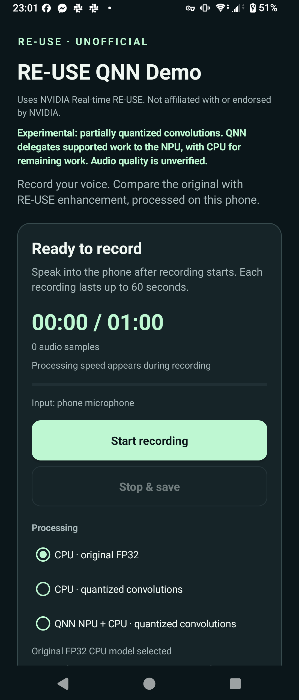

# Conv-only quantization experiments

The eight-Conv candidate passed all eight isolated NPU numerical gates and
completed the full hybrid pipeline on Xperia 1 IV. **Quantized CPU processing
was fastest:** its mean processing time was 8.9% lower than original FP32 in a
58.32-second paced test. QNN hybrid was slower than both CPU modes in that
longer test, so these results do not support an NPU speed-benefit claim.

[Release downloads: APK, reusable library bundle and source](https://github.com/Keitark/RE-USE-android-unofficial/releases/tag/v0.4.0-qnn-mic-preview1).
The release uses the eight-Conv model. The phone app starts in **original FP32
CPU mode**; quantized CPU and QNN NPU + CPU are selectable experiments.

<p align="center">
  
  <br><sub>Xperia UI check; no microphone recording started in this screenshot.</sub>
</p>

These experiments retain native FP32 normalization, PReLU, Mamba operations,
all original initializers and the 21-state streaming ABI. They quantize only
selected Conv operations: UINT8 activations/weights/output, INT32 bias. They
are separate from the rejected grouped-normalization candidates.

The [sanitized receipt](validation/qnn-convolution-experiments.json) records
the model hashes, limits and numerical results. NVIDIA-derived graphs remain
subject to NSCLv1 for noncommercial research and education.

## Keep the variants separate

| Variant | Quantized operations | Status |
| --- | --- | --- |
| Single Conv | Last dense encoder Conv only | Earlier conservative hybrid; see its [separate guide](qnn-hybrid.md) |
| Nine Convs | Dense stages 1, 2 and 3 in encoder, mask decoder and phase decoder | CPU sequence completed; NPU candidate rejected after 8/9 isolated gates passed |
| Eight Convs | Same set, except encoder stage 2 stays FP32 | All eight isolated gates passed; complete short and 58.32-second paced comparisons completed |

The excluded operation is
`/dense_encoder/dense_block/dense_block.2.1/Conv`. Its isolated NPU output had
maximum error **1.066309**, exceeding the predeclared **0.746416** limit on 25
elements. Its numerical gate remains failed. The other eight isolated graphs
passed their original limits; each matching profile was independently read and
contains 25 QNN events with no CPU provider events.

No tolerance was relaxed. The eight-Conv pack retains the same eight passing
isolated model bytes and limits, while keeping the excluded Conv byte-identical
to the original FP32 graph. All eight matching isolated profiles in the new
physical run were independently read and show QNN-only execution.

## Eight-Conv physical results

Short unpaced 8 kHz processing of the 6.48-second public clip, 65 chronological
calls plus flush:

| Backend | Mean call | p95 call | Processing RTF |
| --- | ---: | ---: | ---: |
| Original FP32 on CPU | 66.15 ms | 69.19 ms | 0.6736 |
| Eight-Conv QDQ on CPU | **53.82 ms** | **55.69 ms** | **0.5483** |
| Same eight-Conv graph with QNN + CPU | 57.61 ms | 62.53 ms | 0.5865 |

The quantized CPU mean is **18.6% lower** than FP32 in this short test. Timed
calls and flush are unprofiled. Provider profiling covers three preceding
zero-input warm-ups only; all three matching warm-up profiles were independently
read. The hybrid warm-ups contain 48 QNN and 1,029 CPU kernel events across
three model runs, with 16 QNN partitions per run. Partition counts do not
measure NPU compute share, and no per-timed-call provider trace was collected.

The longer test concatenated the public PCM fixture nine times, **without
resetting model or FIR state between repetitions**, for **58.32 seconds**:

| Paced 16 kHz backend | Mean model-process call | p95 call | Session processing RTF |
| --- | ---: | ---: | ---: |
| Original FP32 on CPU | 70.79 ms | 78.16 ms | 0.7177 |
| Eight-Conv QDQ on CPU | **64.52 ms** | **74.47 ms** | **0.6542** |
| Same eight-Conv graph with QNN + CPU | 72.63 ms | 80.83 ms | 0.7353 |

Each mode processed **584 model calls**, all **933,120 input samples**, and
returned **933,308 output samples**, including one 188-sample FIR tail. Each
reported **zero input drops, queue overflows, sequence gaps and 100 ms processing
deadline misses**. The quantized CPU mean is **8.9% lower** than FP32 here;
the short-test 18.6% reduction must not be presented as the longer-test result.

The 16 kHz public fixture is interpolated from the same 8 kHz source and fed
in 800-sample packets every 50 ms through the production 16→8→16 kHz FIR and
bounded session queue. The model remains 8 kHz. This is a paced input/session
test, not an AudioRecord microphone capture or AudioTrack playout test. It does
not establish perceptual quality, sustained thermal steady state or a general
real-time guarantee.

The device measurements use Sony SO-51C / SM8450, Android 14; ORT 1.29.0, QNN plugin 2.7.0 and
QNN runtime 2.51.0. CPU uses two intra-op threads and one inter-op thread. The
screen was interactive and unlocked, with device idle and power saving off.
Backend order, clocks and thermal conditions were not controlled. These are
processing wall-time measurements, not controlled CPU-cycle measurements.

## Earlier nine-Conv CPU measurements

Sony SO-51C / SM8450, Android 14; ORT 1.29.0, QNN plugin 2.7.0, QNN runtime
2.51.0. The app was visible, the screen interactive and unlocked, device idle
false and power saving off. Backend order, clocks and thermal state were not
controlled. CPU uses two intra-op threads and one inter-op thread.

Unpaced 8 kHz public-clip processing, 65 chronological calls plus flush:

| Backend | Mean call | p95 call | Processing RTF |
| --- | ---: | ---: | ---: |
| Original FP32 on CPU | 66.64 ms | 69.41 ms | 0.6791 |
| Nine-Conv QDQ on CPU | **51.83 ms** | **54.27 ms** | **0.5278** |

Timings include analysis/synthesis and synchronous model execution, excluding
compilation, warm-up and comparisons. Timed calls and flush are unprofiled;
provider attribution was checked during three preceding zero-input warm-ups.
Both matching CPU warm-up profiles were independently read. All 51,840 real
input samples were returned after trimming, with finite output and no process
call exceeding 100 ms.

The same 6.48-second public clip was also fed as **16 kHz PCM**, paced in
800-sample packets every 50 ms, through the actual bounded queue and
16→8→16 kHz FIR/session path. This fixture was interpolated from the public
8 kHz input; the model remains 8 kHz:

| CPU backend | Mean model-process call | p95 call | Session processing RTF |
| --- | ---: | ---: | ---: |
| Original FP32 | 68.93 ms | 75.16 ms | 0.7175 |
| Nine-Conv QDQ | **57.60 ms** | **63.50 ms** | **0.5925** |

Both CPU modes processed all **103,680 input samples**, returned **103,868
samples including the 188-sample FIR tail**, and reported zero drops, queue
overflows and 100 ms processing deadline misses. Model-process call timing and
the complete session RTF have different scopes; the latter includes worker
and drain processing.

This is a paced public-input test, not a microphone recording or speaker
playout test. It does not measure AudioRecord source gaps or AudioTrack
underruns, and it is too short to establish sustained thermal behavior.

**Nine-Conv NPU throughput is not accepted or tabulated.** The unpaced full
hybrid test was skipped after the failed prerequisite. The paced mechanical
QNN pipeline in that test build still ran, but completion of its queue and sample
accounting cannot override a failed model numerical gate.

## Numerical scope

The fresh eight-Conv pack contains eight matching isolated prerequisites and
a complete candidate with the failing encoder Conv retained in FP32. Its
FP32 graft control has zero waveform difference on the host reference sequence.
The quantized candidate remains finite across 65 calls with independent state
feedback.

Host waveform RMSE versus original FP32 is **0.0006544** for eight Convs,
compared with **0.0006099** for nine Convs on this one clip. Fewer quantized
operations do not guarantee a lower error for every input. These are waveform
differences, with no perceptual quality acceptance threshold; one calibration
clip cannot establish general speech quality.

The earlier single-Conv results and the nine-Conv CPU results remain separate
records and must not be relabelled as eight-Conv measurements.

## Try or build the phone demo

The release phone app is **RE-USE QNN Demo (Unofficial)**, package
`io.github.reuse.phone.qnn`, version `0.4.0-qnn-mic-preview1`. It includes original
FP32 CPU, eight-Conv quantized CPU and eight-Conv QNN + CPU modes. Start with
the default FP32 mode, then compare the experimental modes and share diagnostics.
The public-input tests above do not constitute a live microphone recording test.

For a source build, prepare the pinned model, public NVIDIA sample and host
custom-op library using the [build setup](qnn-probe.md#build-from-source).
Run missing generation steps into fresh directories; existing experiment packs
are preserved:

```powershell
.venv\Scripts\python.exe tools\prepare_qnn_probe.py --custom-op-library native/build-qnn-reference/Release/reuse_ort_ops.dll
.venv\Scripts\python.exe tools\prepare_qnn_conv_hybrid.py --custom-op-library native/build-qnn-reference/Release/reuse_ort_ops.dll
.venv\Scripts\python.exe tools\prepare_qnn_multiconv.py --custom-op-library native/build-qnn-reference/Release/reuse_ort_ops.dll --output .research/qnn-eightconv-assets --exclude-node /dense_encoder/dense_block/dense_block.2.1/Conv
.\gradlew.bat :phone-demo:assembleDebug -PreuseQnnExperimental=true -PreuseNeonFma=true -PreuseScanN16Registers=true
```

The phone demo and probe now select the eight-Conv assets by default. Generated
models/public fixtures stay outside Git. The selected candidate model SHA-256 is
`2820cc12668018ff3228020fe2b645aec726de768bcab25cbd91f37524b5f87f`.
